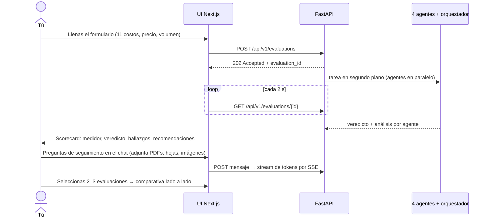
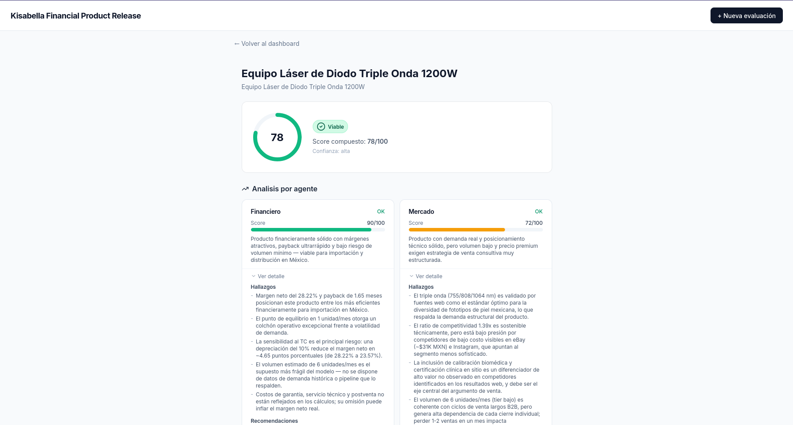
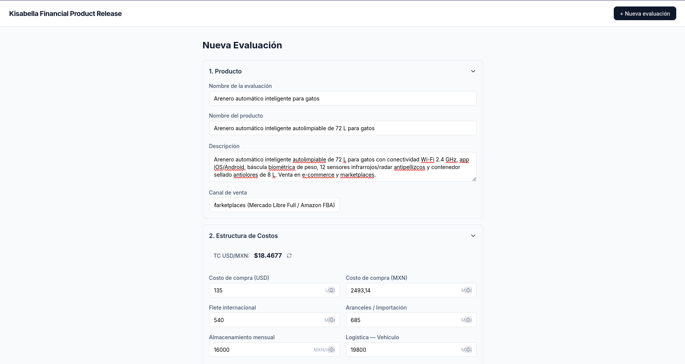
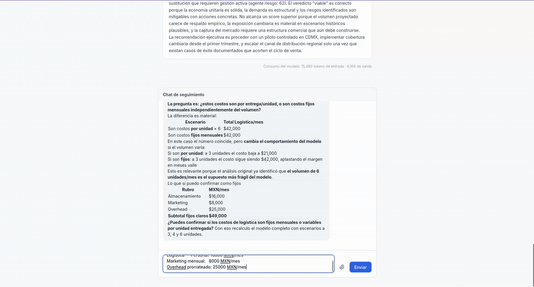
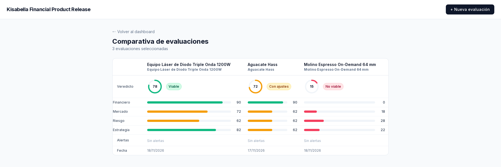

<div align="center">

# Kisabella Financial Product Release

**IA multi-agente que te dice si un producto físico vale la pena lanzarlo — antes de gastar el dinero.**

[](README.md)

[](https://github.com/AdonnayBazaldua/KISABELLA-Financial-product-release-approach/actions/workflows/ci.yml)
[](LICENSE)
[](https://www.python.org/)
[](https://fastapi.tiangolo.com/)
[](https://langchain-ai.github.io/langgraph/)
[](https://www.anthropic.com/)
[](https://nextjs.org/)
[](https://www.typescriptlang.org/)
[](https://tailwindcss.com/)
[](https://www.postgresql.org/)
[](https://docs.docker.com/compose/)

</div>

---

## Qué hace

Describes una idea de producto: costo del proveedor, flete, aranceles, logística, comisiones, marketing, precio y volumen esperado (11 componentes de costo en total). Cuatro agentes especialistas la analizan **en paralelo** y un orquestador integra su trabajo en un solo veredicto:

| Agente | Qué analiza | Score |
|---|---|---|
| **Financiero** | Márgenes, ROI, punto de equilibrio, payback, sensibilidad al TC ±10 % | Determinístico (calculado, no adivinado por el LLM) |
| **Mercado** | Precios de competidores, demanda, canal (búsqueda web opcional con Tavily) | LLM |
| **Riesgo** | Exposición cambiaria, concentración de costos, colchón de margen, regulación, sustitución | LLM |
| **Estrategia** | Precio recomendado, canal, volumen mínimo rentable, entrada al mercado | LLM |
| **Orquestador** | Resuelve contradicciones y redacta la justificación | Sin score propio |

El score final es un promedio ponderado (Financiero 35 %, Mercado 25 %, Riesgo 20 %, Estrategia 20 %) que se traduce en uno de tres veredictos: `viable`, `viable_con_ajustes` o `no_viable`. Si fallan agentes, el sistema degrada con gracia: 2 OK → "viable con ajustes" marcado para revisión humana; ≤ 1 OK → `no_viable` con "datos insuficientes".

> Está pensado para **importadores / distribuidores / revendedores en México** (costos en USD, ventas en MXN, TC de Banxico). La interfaz, los prompts y el análisis están en español.

## Cómo se interactúa



1. **Evalúa** – llena el formulario; el tipo de cambio USD/MXN se sugiere solo (editable).
2. **Lee el scorecard** – medidor global, veredicto, score por agente, hallazgos y recomendaciones (300–500 palabras de análisis cada uno).
3. **Chatea** – haz preguntas de seguimiento con respuestas en streaming; adjunta PDF, DOCX, XLSX, CSV, TXT o imágenes (máx. 3 archivos × 5 MB).
4. **Compara** – marca 2–3 evaluaciones en el dashboard para decidir cuál priorizar.

## Capturas









## Inicio rápido

Requisitos: [Docker](https://docs.docker.com/get-docker/) con Compose v2 y **tu propia** [API key de Anthropic](https://console.anthropic.com/).

```bash
git clone https://github.com/AdonnayBazaldua/KISABELLA-Financial-product-release-approach.git && cd KISABELLA-Financial-product-release-approach
cp .env.example .env
# edita .env → define ANTHROPIC_API_KEY, DB_PASSWORD y APP_DB_PASSWORD
docker compose up --build
```

Abre <http://localhost:3000>. La documentación de la API está en <http://localhost:8000/docs>.

> ⚠️ **Costo:** cada evaluación hace ~5 llamadas al LLM que se cobran a *tu* cuenta de Anthropic (tope de 6 llamadas / ~20 k tokens de entrada estimados por evaluación; cada llamada se reintenta hasta 3 veces ante errores transitorios de la API). Cada mensaje de chat es una llamada más.
>
> 🔒 **Sin autenticación:** la app no tiene login y escucha solo en `127.0.0.1` a propósito. No la expongas a internet tal cual; si la despliegas, ponla detrás de un reverse proxy con HTTPS y define `ALLOWED_IPS` (y `FORWARDED_ALLOW_IPS` con la dirección de tu proxy, para que el backend vea la IP real del cliente).

Llaves opcionales en `.env`: `TAVILY_API_KEY` (búsqueda web del agente de Mercado) y `BANXICO_TOKEN` (tipo de cambio oficial). Sin ellas la app funciona igual (sin búsqueda web / TC manual).

## Stack

| Capa | Tecnología |
|---|---|
| Frontend | Next.js 15 (App Router), TypeScript, Tailwind CSS, Radix UI |
| Backend | FastAPI, Python 3.12, SQLAlchemy 2 async, Alembic |
| IA | Claude (`claude-sonnet-4-6`) vía `langchain-anthropic`, orquestado con LangGraph; salida estructurada validada con Pydantic |
| Datos | PostgreSQL 16 con Row-Level Security forzado (la app se conecta con un rol no-dueño) |
| Integraciones | Banxico (USD/MXN), Tavily (búsqueda web), `markitdown` (archivo → texto) |
| Infra | Docker Compose (contenedores sin root), CI con GitHub Actions |

## Desarrollo

```bash
# backend
cd backend && python -m venv .venv && . .venv/bin/activate
pip install -r requirements-dev.txt
pytest -q                      # ~295 tests, sin red, el LLM es falso

# frontend
cd frontend && npm ci && npm run build
npm test && npm run check:types   # tests unitarios + tipos de la API sincronizados con el backend

# test de RLS con Postgres real y smoke del stack completo (requieren Docker)
scripts/test-rls.sh
scripts/smoke.sh
```

Los agentes son funciones async simples ensambladas con `build_agent()` (`backend/agents/`); los prompts son archivos Markdown en `backend/agents/prompts/` que puedes editar sin tocar Python. Decisiones de diseño: [`docs/adr/`](docs/adr/). Contribuir: [CONTRIBUTING.md](CONTRIBUTING.md) · Seguridad: [SECURITY.md](SECURITY.md).

## Limitaciones conocidas

- Solo un worker de backend: las colas de streaming del chat y las cachés viven en memoria.
- Un único usuario implícito (sin cuentas); pensado para un equipo pequeño de confianza.
- No es asesoría financiera. Los scores salen de heurísticas más un LLM: tómalos como una segunda opinión estructurada, no como una decisión.

## Licencia

[MIT](LICENSE)
