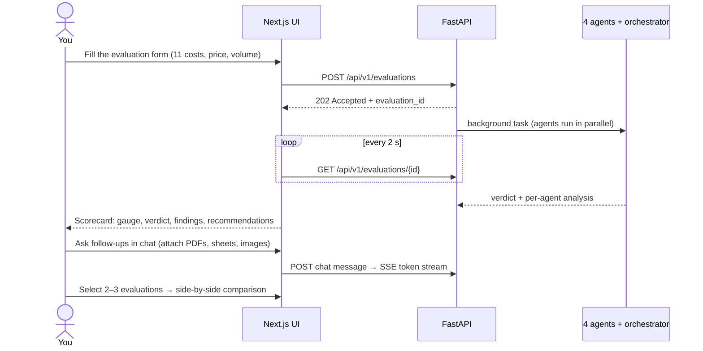

<div align="center">

# Kisabella Financial Product Release

**Multi-agent AI that tells you whether a physical product is worth launching — before you spend the money.**

[](README.es.md)

[](https://github.com/AdonnayBazaldua/KISABELLA-Financial-product-release-approach/actions/workflows/ci.yml)
[](LICENSE)
[](https://www.python.org/)
[](https://fastapi.tiangolo.com/)
[](https://langchain-ai.github.io/langgraph/)
[](https://www.anthropic.com/)
[](https://nextjs.org/)
[](https://www.typescriptlang.org/)
[](https://tailwindcss.com/)
[](https://www.postgresql.org/)
[](https://docs.docker.com/compose/)

</div>

---

## What it does

You describe a product idea — supplier cost, freight, duties, logistics, commissions, marketing, price and expected volume (11 cost components in total). Four specialist agents analyse it **in parallel**, and an orchestrator merges their work into a single verdict:

| Agent | Looks at | Score |
|---|---|---|
| **Financial** | Margins, ROI, break-even, payback, ±10 % FX sensitivity | Deterministic (computed, not LLM-guessed) |
| **Market** | Competitor pricing, demand, channel fit (optional live web search via Tavily) | LLM |
| **Risk** | FX exposure, cost concentration, margin safety buffer, regulation, substitution | LLM |
| **Strategy** | Recommended price, channel, minimum viable volume, go-to-market | LLM |
| **Orchestrator** | Reconciles contradictions, writes the justification | No score of its own |

The final score is a weighted average (Financial 35 %, Market 25 %, Risk 20 %, Strategy 20 %) mapped to one of three verdicts: `viable`, `viable_con_ajustes` (viable with adjustments) or `no_viable`. If agents fail, the system degrades gracefully: 2 OK → "viable with adjustments" flagged for human review; ≤ 1 OK → `no_viable` with "insufficient data".

> It is built for **importers / distributors / resellers in Mexico** (costs in USD, sales in MXN, FX from Banxico). The UI, prompts and analysis are in Spanish.

## How you interact with it



1. **Evaluate** – fill the form; the USD/MXN rate is suggested automatically (editable).
2. **Read the scorecard** – overall gauge, verdict, per-agent score, key findings and recommendations (300–500 words of analysis each).
3. **Chat** – ask follow-up questions with streaming answers; attach PDF, DOCX, XLSX, CSV, TXT or images (max 3 files × 5 MB).
4. **Compare** – tick 2–3 evaluations on the dashboard to decide which to prioritise.

## Quick start

Requirements: [Docker](https://docs.docker.com/get-docker/) with Compose v2, and **your own** [Anthropic API key](https://console.anthropic.com/).

```bash
git clone https://github.com/AdonnayBazaldua/KISABELLA-Financial-product-release-approach.git && cd KISABELLA-Financial-product-release-approach
cp .env.example .env
# edit .env → set ANTHROPIC_API_KEY, DB_PASSWORD and APP_DB_PASSWORD
docker compose up --build
```

Open <http://localhost:3000>. The API docs are at <http://localhost:8000/docs>.

> ⚠️ **Cost:** every evaluation makes ~5 LLM calls billed to *your* Anthropic account (capped at 6 calls / ~20 k estimated input tokens per evaluation; a call is retried up to 3 times on transient API errors). Each chat message is one more call.
>
> 🔒 **No user auth:** the app has no login and is bound to `127.0.0.1` on purpose. Do not expose it to the internet as-is; if you deploy it, put it behind a reverse proxy with HTTPS and set `ALLOWED_IPS` (and `FORWARDED_ALLOW_IPS` to your proxy's address, so the backend sees the real client IP).

Optional keys in `.env`: `TAVILY_API_KEY` (live web search for the Market agent) and `BANXICO_TOKEN` (official FX rate). Without them the app still works (no web search / manual FX).

## Tech stack

| Layer | Technology |
|---|---|
| Frontend | Next.js 14 (App Router), TypeScript, Tailwind CSS, Radix UI |
| Backend | FastAPI, Python 3.12, async SQLAlchemy 2, Alembic |
| AI | Claude (`claude-sonnet-4-6`) via `langchain-anthropic`, orchestrated with LangGraph; Pydantic-validated structured output |
| Data | PostgreSQL 16 with enforced Row-Level Security (the app connects as a non-owner role) |
| Integrations | Banxico (USD/MXN), Tavily (web search), `markitdown` (file → text) |
| Infra | Docker Compose (non-root containers), GitHub Actions CI |

## Development

```bash
# backend
cd backend && python -m venv .venv && . .venv/bin/activate
pip install -r requirements-dev.txt
pytest -q                      # ~295 tests, no network, LLM is faked

# frontend
cd frontend && npm ci && npm run build
npm test && npm run check:types   # unit tests + API types in sync with the backend

# real-Postgres RLS test and full-stack smoke test (need Docker)
scripts/test-rls.sh
scripts/smoke.sh
```

Agents are plain async functions assembled by `build_agent()` (`backend/agents/`); prompts are Markdown files in `backend/agents/prompts/` that you can edit without touching Python. Design decisions: [`docs/adr/`](docs/adr/). Contributing: [CONTRIBUTING.md](CONTRIBUTING.md) · Security: [SECURITY.md](SECURITY.md).

## Known limitations

- Single backend worker only: chat streaming queues and API caches live in memory.
- Single implicit user (no accounts); built for a small trusted team.
- Not financial advice. Scores come from heuristics plus an LLM — treat them as a structured second opinion, not a decision.

## License

[MIT](LICENSE)
